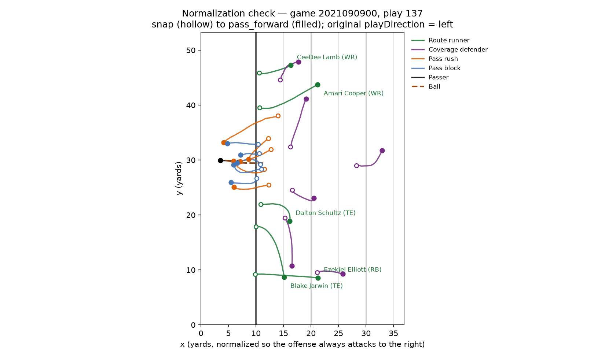
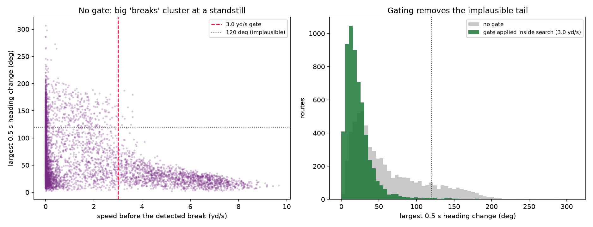

# EDA Findings — Break Sharpness vs. Man/Zone Coverage

Reproduce with `python -m src.eda`. Full console output: [`outputs/eda_report.txt`](outputs/eda_report.txt).

## The three first checks all pass

**Coverage column.** `pff_passCoverageType` is the man/zone label, and it has **no missing
values** across all 8,557 plays: Zone 65.3%, Man 29.0%, Other 5.7%. It maps cleanly onto
`pff_passCoverage` with no contradictions — Cover-0/1 and 2-Man are the Man schemes,
Cover-2/3/6 and Quarters are Zone, and "Other" is the junk bucket (Red Zone, Bracket,
Goal Line, Prevent, Miscellaneous). **Drop "Other"**; it is a grab bag, not a scheme.

**Events.** `ball_snap` appears on 99.9% of plays and `pass_forward` on 87.8%. Across all
122 games, **7,525 of 8,554 plays (88.0%)** have a usable snap-to-throw window. The 12%
that drop out are exactly what we expected: sacks (`passResult == S`) and scrambles (`R`).
Retention is essentially identical for man (86.1%) and zone (88.3%), so dropping them does
not bias the comparison. Snap-to-throw averages 2.8 s (median 2.6 s, 5th pct 1.8 s), and
**no play is shorter than 1.5 s**, so a 0.5 s break window always fits.

**Normalization.** Verified on game 2021090900 and across 12 sampled games. After flipping
x, y, `o`, and `dir` for left-direction plays, receiver downfield drift from snap to throw
is statistically identical for both original play directions (left: median +7.00 yd, 92.8%
positive; right: median +7.32 yd, 91.9% positive). Pass blockers correctly show negative
drift, since they drop back.

## The metric has a real bug, and the EDA caught it

Taking "the largest direction change over a 0.5 s window" literally **does not measure a
route break**. On 6,240 route windows (first 20 games) the detector lands at a median speed
of **0.18 yd/s**,
and 61% of detected "breaks" happen below 1.0 yd/s. The reason: `dir` is meaningless when a
player is standing still, and the receiver is standing still at the snap, which is inside
our window. Worse, the speed-retention term *rewards* this — a player going from 0.03 to
0.53 yd/s scores retention 1.0. The result is that **14.7% of routes get a "break" over
120°**, which no receiver performs in half a second.

Two fixes, both confirmed:

1. **Unwrap `dir` before differencing.** Raw `dir` produces 84 frame-to-frame jumps over
   180° on a single game; these are 0/360 wraparound artifacts, not turns. `np.unwrap` on
   radians drops that to zero.
2. **Gate on pre-break speed, inside the search, not after it.** Filtering routes whose
   unfiltered argmax is slow throws away 75% of the data. Instead, search for the largest
   heading change *among frames that clear the gate*. At a **3.0 yd/s gate this keeps 94.6%
   of routes** while cutting implausible (>120°) breaks from 14.7% to 0.9% and pulling the
   mean break angle from 61° to a believable 23°.

## Sample sizes are comfortable

**32,495 route-level observations** (9,797 man / 22,698 zone) survive every filter:

| Position | Man | Zone | Total |
|---|---|---|---|
| WR | 5,951 | 13,232 | 19,183 |
| TE | 2,234 | 5,235 | 7,469 |
| RB | 1,612 | 4,231 | 5,843 |

Routes come from `pff_role == 'Pass Route'` (39,513 rows), of which 98.9% are WR/TE/RB, at
4.57 routes per play. At a 30-route minimum the leaderboard has 149 WR, 69 TE, and 70 RB,
and **134 players clear 30 routes in both man and zone**, which is enough to split the
leaderboard by coverage. Cooper Kupp has 208 routes (151 zone, 57 man), so the planned
player callout is viable.

Separation at the throw computes cleanly with zero implausible values. On game 2021090900
(435 receiver-frames) the median is 2.85 yd with a 5th–95th percentile of 0.75–8.56 yd,
which is in line with public NGS separation numbers. It varies sharply by position
(median WR 2.44, TE 2.17,
**RB 5.43**), which is a warning that the WR/TE/RB facet is mandatory — RBs are not
comparable to WRs, and "nearest coverage defender" is a weak proxy for a back leaking out.

## Man and zone are not called in the same situations

This is the biggest threat to the headline, and it is substantial. Defenses play man on
short yardage and late downs:

| Yards to go | Man rate |
|---|---|
| 1–3 | 50.3% |
| 4–6 | 44.7% |
| 7–10 | 26.1% |
| 16+ | 11.8% |

Man rate is 21.5% on first down but 46.9% on third and 58.3% on fourth. Man plays also
average 7.6 yards to go versus 9.4 for zone, carry less play action (17.7% vs 26.2%), and
are thrown slightly quicker (2.84 s vs 2.97 s). Completion rate against man is 53.1% versus
65.3% against zone.

So a raw man-vs-zone separation gap partly reflects **down, distance, and route depth**, not
coverage response to the break. The main chart must facet by position at minimum, and the
claim should be checked while holding time-to-throw and yards-to-go roughly fixed.

## Decisions carried into the main analysis

- Keep `pff_passCoverageType` in `{Man, Zone}`; drop `Other` (417 plays).
- Window = `ball_snap` to first `pass_forward`; drop plays missing either.
- Routes = `pff_role == 'Pass Route'` joined to WR/TE/RB.
- Unwrap `dir` in radians before measuring any angle change.
- Require ≥ 3.0 yd/s before the break when searching for it.
- Facet everything by WR/TE/RB; report time-to-throw and yards-to-go alongside.
- `outputs/play_windows.csv` caches the snap/throw frame index for all 7,525 usable plays.
