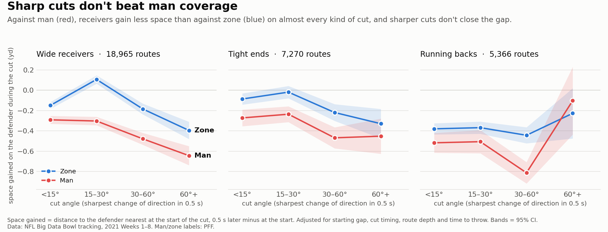
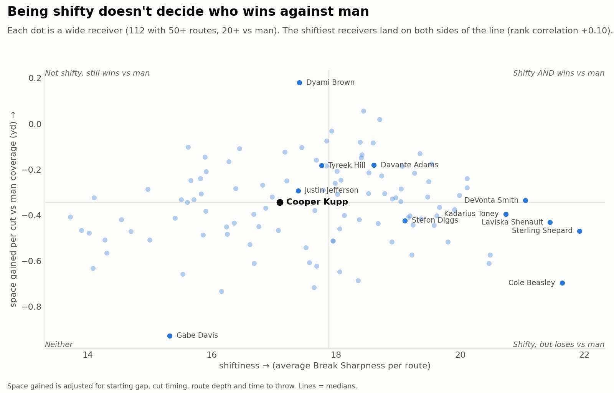
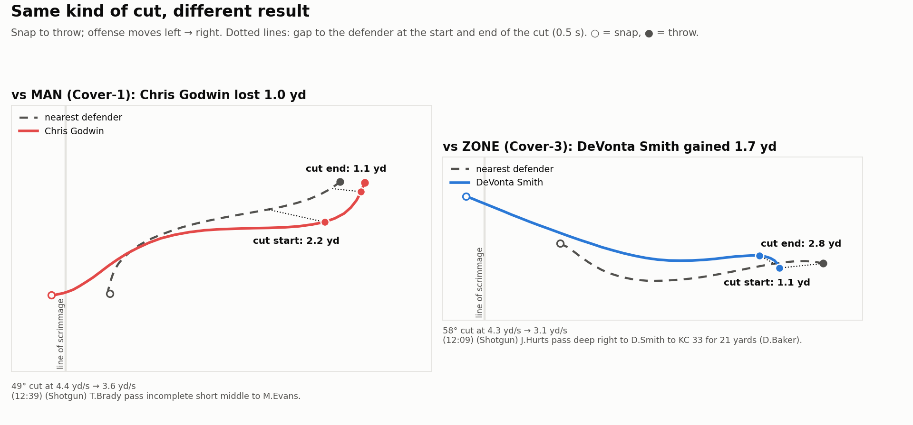

# Sharp Cuts Don't Beat Man Coverage

NFL Big Data Bowl, NYU Edition · 2021 season, Weeks 1–8 · **For coaches and scouts**

Coaches call sharp-breaking routes "man beaters." We measured the cut on **31,601 routes** from 2021 Next Gen Stats tracking data and found that sharp cuts gain **no extra space against man coverage**. Instead, man defenders take away about **0.3 yards more on every cut, sharp or soft**, so a receiver needs something other than a hard cut to win against man.



*How to read it:* each point is the average space a receiver gains on his defender during the cut, for one range of cut angles. The red (man) line sits below the blue (zone) line in 11 of 12 points, and sharper cuts never close the gap.

*Running backs are shown for completeness but are the least reliable panel. Their sharpest "break" is often the turn out of the backfield rather than a cut against a defender, the nearest coverage defender is a weaker stand-in for who is covering them, and the 60°+ bin has only 42 man routes. The headline rests on wide receivers and tight ends.*

## The result in one table

Fair comparison of similar cuts (same starting gap, same timing, same route depth, same time to throw):

| | Wide receivers | Tight ends | Running backs |
|---|---|---|---|
| Routes | 18,965 | 7,270 | 5,366 |
| **Space lost vs man, per cut** | **−0.31 yd** | **−0.24 yd** | −0.19 yd |
| Do sharper cuts help *more* vs man? | No (−0.02, not significant) | No (−0.02, n.s.) | No (−0.04, n.s.) |
| Keeping speed through the cut | Helps slightly (+0.05 yd) | Helps slightly (+0.07 yd) | Hurts (−0.11 yd) |

If the coaching belief were true, the second row would be clearly positive. It isn't, for any position.

## Who's the shiftiest, and does it pay off?



Shiftiness (a player's average Break Sharpness) barely predicts who wins against man: rank correlation **+0.10** across 112 wide receivers. **4 of the 5 shiftiest WRs gain less space against man than the median receiver**, and the best receiver against man, Dyami Brown, is only mid-pack on shiftiness.

Shiftiest players (at least 50 routes, 20 against man; full list in [`outputs/leaderboard.csv`](outputs/leaderboard.csv)):

| Rank | Wide receiver | Space vs man | Space vs zone | | Tight end | Space vs man | Space vs zone |
|---|---|---|---|---|---|---|---|
| 1 | Sterling Shepard | −0.47 | −0.16 | | Jack Doyle | −0.45 | −0.32 |
| 2 | Cole Beasley | −0.70 | −0.24 | | Dallas Goedert | −0.40 | −0.16 |
| 3 | Laviska Shenault | −0.43 | +0.18 | | Mike Gesicki | −0.39 | −0.08 |
| 4 | DeVonta Smith | −0.34 | −0.21 | | Cameron Brate | −0.37 | −0.04 |
| 5 | Kadarius Toney | −0.40 | −0.21 | | Travis Kelce | −0.28 | −0.28 |

*Space = average yards gained on the defender per cut, adjusted. Median WR vs man: −0.34.*

## Same kind of cut, different result



Two real plays with similar cuts. **Against man (Cover-1)**, Chris Godwin's 49° cut doesn't shake his defender, who closes from 2.2 to 1.1 yards, and the pass falls incomplete. **Against zone (Cover-3)**, DeVonta Smith's 58° cut opens the gap from 1.1 to 2.8 yards, and he catches a 21-yard pass.

## Player callout: Cooper Kupp

Kupp (2021 Triple Crown season) ranks only **72nd of 112 WRs in shiftiness** and is exactly average against man (56th). Against zone he's **5th best** (+0.22 yd per cut), and his man-vs-zone gap is the 10th largest of the 112. **Kupp doesn't win by cutting; he wins by finding space against zone.**

## What coaches and scouts can do with this

- **Coaches:** don't pick your "man beaters" by how sharply a receiver cuts. Against man-heavy defenses, sharp cuts alone don't buy extra space, so the space has to come from somewhere else.
- **Scouts:** shiftiness is a style, not a predictor of winning against man. Grade man and zone separately: a receiver like Kupp can be average against man and elite against zone.

## How we measured it

**1. Break Sharpness (the stat).** For each route between the snap and the throw, we find the receiver's largest change of direction over 0.5 s (5 frames at 10 fps) and multiply it by how much speed he kept (speed after ÷ speed before, capped at 1).
- Before measuring, every play is flipped so the offense moves the same way.
- Direction is *unwrapped* so a heading going from 359° to 1° counts as a 2° turn, not 358°.
- **The EDA caught a real bug.** Taken literally, the "largest direction change" lands on the snap, when the receiver is standing still and his direction reading is meaningless: 61% of detected "breaks" happened below 1 yd/s, and 14.7% were over 120°. We only let a break start once the receiver is moving at least **3 yd/s**, which cuts impossible breaks to under 1% and still scores **97% of routes**. Details: [`EDA_FINDINGS.md`](EDA_FINDINGS.md).

**2. Space gained (the outcome).** When the cut starts, we find the nearest coverage defender and measure the gap to **that same defender** again 0.5 s later, when the cut ends. Following one defender isolates what the cut did to the man on him.

**3. Fair comparison.** Sharper cuts tend to happen later in the route and start with the defender closer, and both change how much space opens up regardless of the cut. Without adjusting, sharp cuts look like they create space; once we compare similar situations, that effect disappears. We adjust for **starting gap, cut timing, route depth and time to throw**, using a regression with robust standard errors ([`outputs/regression_summary.csv`](outputs/regression_summary.csv)).

**Sample:** 122 games, 7,105 pass plays labeled man or zone by PFF (sacks, scrambles and "Other" coverages removed), 31,601 WR/TE/RB routes (9,435 vs man, 22,166 vs zone).

## Limitations

- **Most "breaks" are small adjustments, not cuts.** 81% of WR routes have their biggest turn under 30°; about 3,700 WR routes have a real cut (30°+). That's why the main chart is split by cut angle.
- **One break per route.** We score the largest direction change only.
- **Nearest defender stands in for the covering defender.** PFF tells us who was in coverage, not who was assigned to whom.
- **Space is measured during the cut, not at the catch.** Tracking ends about 0.5 s after the throw, so there's no separation at the catch.
- **All routes count, not just targeted ones,** which keeps the quarterback's choices out of the measure.
- **Running backs:** see the note under the main chart.
- **Effects are modest.** The man-vs-zone gap is very clear statistically, but each individual cut is noisy (R² 0.07–0.12).

## How to run

Requires Python 3.11+ (developed on 3.13). All results are already committed in `outputs/`, so you only need to run this to reproduce them.

1. Clone this repo:

   ```bash
   git clone https://github.com/amoghkr1shna/nyu-nfl-2026 && cd nyu-nfl-2026
   ```

2. Download the data (about 830 MB; not stored in this repo):

   ```bash
   git clone https://github.com/ThompsonJamesBliss/nfl-big-data-bowl-regional-event-data data/nfl-big-data-bowl-regional-event-data
   ```

3. Install dependencies:

   ```bash
   pip install -r requirements.txt
   ```

4. Run everything (about a minute):

   ```bash
   python run.py
   ```

   Add `--eda` to also rerun the exploratory checks.

## Repo layout

```
run.py              one command: metrics -> analysis -> charts
src/paths.py        file paths, loaders, direction normalization
src/eda.py          data checks (report: outputs/eda_report.txt)
src/metrics.py      Break Sharpness + space gained for every route
src/analysis.py     fair man-vs-zone comparison + leaderboard
src/charts.py       the three figures above
EDA_FINDINGS.md     what the data checks found, and the bug they caught
outputs/            results: route_metrics.csv, coverage_effect.csv,
                    regression_summary.csv, leaderboard.csv, figures/
data/               raw data, downloaded separately (git-ignored)
```

## Data

- Tracking, plays, players and PFF scouting data: [NFL Big Data Bowl regional event data](https://github.com/ThompsonJamesBliss/nfl-big-data-bowl-regional-event-data) (NFL Next Gen Stats, Pro Football Focus), 2021 season Weeks 1–8.
- No external data was used.
